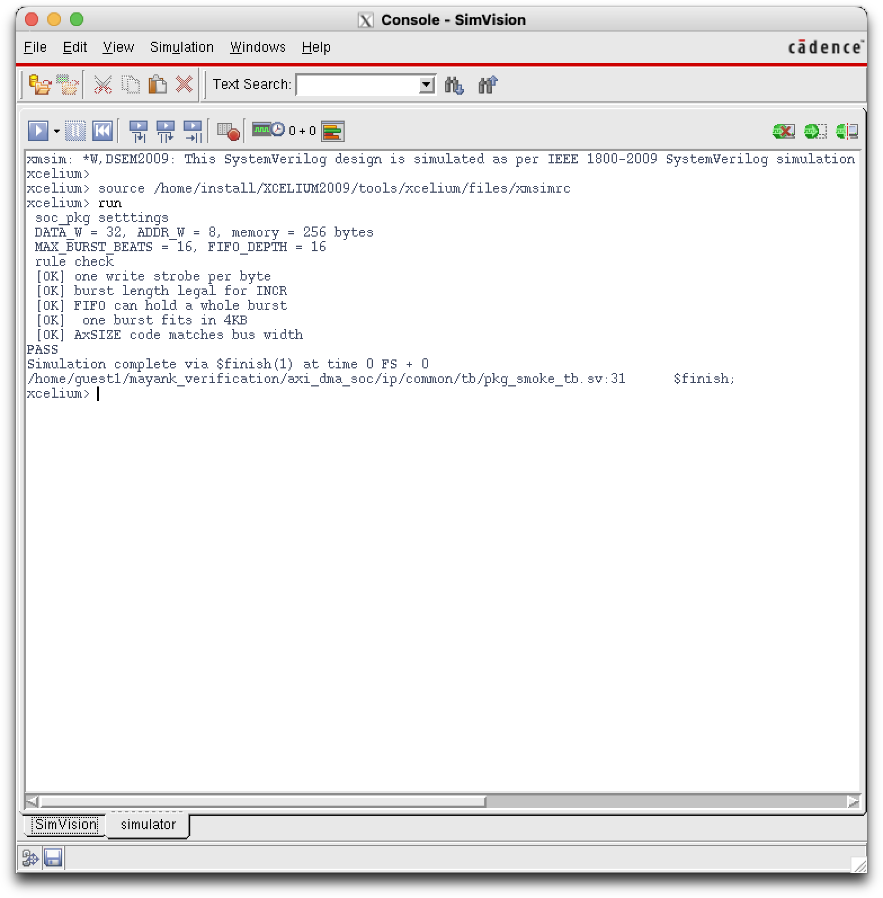
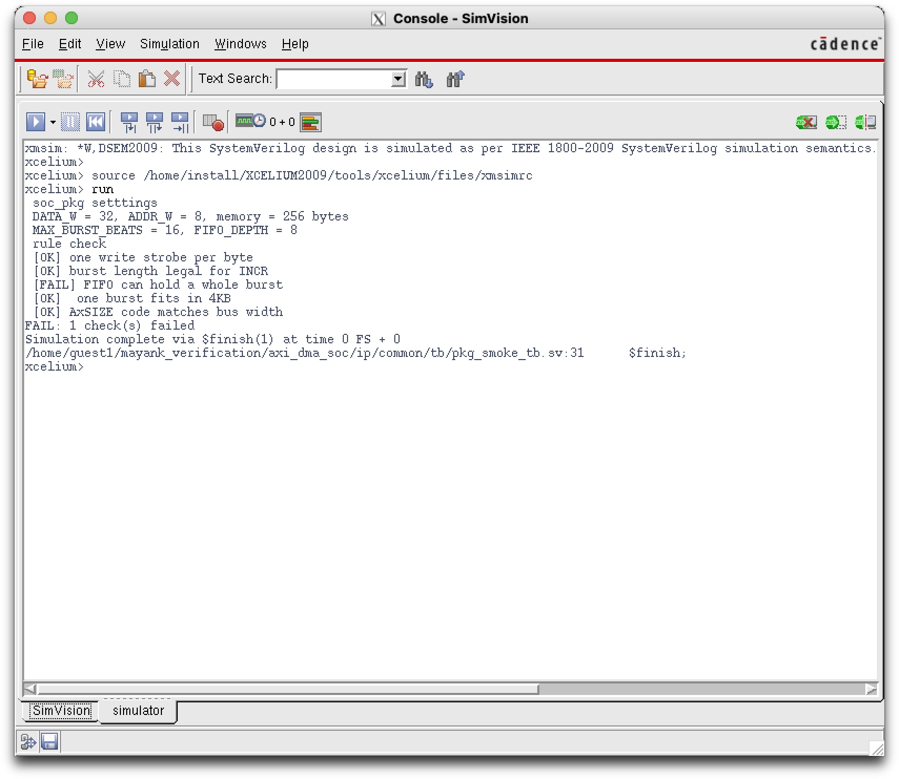

# Step 1 — Project setup

## 1. Goal

Set up the project so that every later block has a fixed home, shared
settings, and a one-command way to run tests. No hardware yet, only the
foundation, proved to work on Cadence Xcelium.


## 2. What I built

| File | What it does 
|---|---|---|
| `.gitignore` | Tells Git never to save simulator junk, logs, Mac files and editor settings 
| `ip/common/rtl/soc_pkg.sv` | Package with every size (data width, address width, burst length, FIFO depth) and AXI code numbers 
| `ip/common/tb/pkg_smoke_tb.sv` | Test that prints the settings and checks them against AXI rules; ends with PASS or FAIL 
| `ip/common/common.f` | File list for the block, package first 
| `sim/setup.csh` | Loads Cadence tools, adds Xcelium to PATH, sets `PROJ_ROOT` 
| `sim/Makefile` | `make xrun`, `make gui`, `make clean` 

## 3. Key ideas I learned

**One source of truth.** All sizes live in `soc_pkg`. If the data bus changes
from 32 to 64 bits, I edit one line; `STRB_W` and `SIZE_FULL` update by
themselves because they are calculated from `DATA_W`.

**FIFO_DEPTH = MAX_BURST_BEATS.** The AXI spec (p.41) says a manager must be
able to finish a transaction once it starts. The DMA only starts reading a
burst when the FIFO has room for all of it, so the FIFO must hold at least one
full burst. Otherwise reading and writing could wait on each other forever
(deadlock).

**Sized hardware types.** `logic [1:0]` is a bundle of exactly 2 wires, and
`2'b01` is a 2-bit binary number. Unlike C, hardware lets me choose the exact
number of bits, because every bit costs silicon.

**SystemVerilog vs C:**

| C | SystemVerilog |
|---|---|
| `#define X 32` | `localparam int X = 32;` |
| `#include "x.h"` | `import soc_pkg::*;` |
| `printf("%d\n", x)` | `$display("%0d", x)` |
| `int main()` | `initial begin ... end` |
| `void f(int x)` | `task automatic f(input int x)` |
| `{ }` | `begin ... end` |

## 4. How to run

```
ssh -Y username@ipaddress
cd ~/mayank_verification/axi_dma_soc/sim
csh
source setup.csh
make gui TEST=pkg_smoke     # then press Run in SimVision
```

## 5. Results

The smoke test checks five rules:

1. One write strobe per byte (`STRB_W * 8 == DATA_W`)
2. Burst length legal for INCR (1 to 256, spec p.44)
3. FIFO can hold a whole burst (spec p.41)
4. One burst fits inside 4KB (spec p.43)
5. AxSIZE code matches the bus width (spec p.43)

**Xcelium 20.09: PASS, 5/5 checks.**



## 6. Proving the test works (bug injection)

A test that has never failed might be broken and always say PASS. So I
planted a bug on purpose: `FIFO_DEPTH = 8` (smaller than a 16-beat burst).
The test printed `[FAIL] FIFO can hold a whole burst` and
`FAIL: 1 check(s) failed`. Then I restored the correct value.



## 7. Problems I hit and how I fixed them

| Problem | Cause | Fix |
|---|---|---|
| `.vscode/sftp.json` appeared in Git changes | A typo turned `.vscode/` into `.vscode/s` in `.gitignore` | Fixed the line; always read the change list before committing |
| `localparam int STRB_W DATA_W/8;` | Missing `=` | Added `=` (syntax error, like `int x 5;` in C) |
| `BBURST_FIXED`, `RES_SLVERR` | Typos in names | Renamed; consistent name prefixes make typos visible |
| `inout string what` in a task | `inout` needs something writable; a text literal is not | Changed to `input` |
| Commands ran on my Mac, not the server | The VS Code terminal was not connected yet | `ssh -Y` first; always check the prompt (`ace@` = Mac, `guest1@cadenceec` = server) |
| `*E,FILEMIS: Cannot find the provided file` | Relative paths (`../../`) used from the wrong folder | Full paths through `$PROJ_ROOT`, then the Makefile |
| `xrun: command not found` | Lab setup does not add Xcelium to PATH | `setup.csh` adds `/home/install/XCELIUM2009/tools/bin` |
| Many `DLCVAR` / `DLCPTH` warnings | Lab `cds.lib` points to a PDK path that does not exist | Harmless; my design had 0 errors |

## 8. Interview questions

**Why keep all sizes in a package instead of typing 32 in each file?**
One source of truth: one edit changes every block, and blocks can never
disagree about a size.

**Why must the FIFO be at least one burst deep?**
AXI requires a manager to finish a transaction without depending on other
transactions (spec p.41). If the FIFO could not hold a full burst, the read
side could stall waiting for space while the write side waits for a full
burst: a deadlock.

**What is a `.f` file and why does the package come first?**
A list of source files passed to the simulator with `-f`. Files compile in
order, and every block imports `soc_pkg`, so it must be compiled first.

**How do you know your test is not one that always passes?**
Bug injection: I set `FIFO_DEPTH = 8` and saw the test report FAIL.
