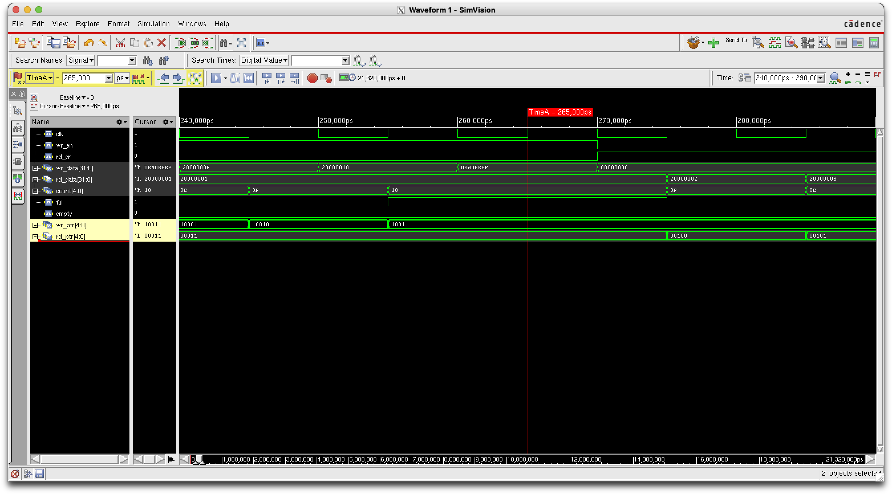

# Step 2 — FIFO + self-checking testbench

## 1. Goal

Build the FIFO that sits between the DMA's read side and write side, and
prove it works with a testbench that checks itself: corner cases first,
then random testing with coverage.

## 2. What I built

| File | What it does |
|---|---|
| `ip/dma/rtl/dma_fifo.sv` | 16 x 32-bit FIFO. First word falls through (oldest item always on `rd_data`). Pointers have an extra "lap" bit to tell full from empty |
| `ip/dma/tb/dma_fifo_tb.sv` | Self-checking testbench: reference model, 6 directed tests, 1 random test with coverage counters |
| `ip/dma/dma.f` | File list for the DMA block |
| `sim/Makefile` | Added the `fifo` test, and `SEED=n` to repeat any random run |
| `sim/setup.csh` | No longer sets PROJ_ROOT; the Makefile finds the project folder itself |
| `sim/run_icarus.sh`, `sim/waves.sv` | Run the FIFO test on my laptop with Icarus Verilog (`sh run_icarus.sh waves` also saves a waveform) when the Cadence server is not available |

## 3. Key ideas I learned

**Full vs empty.** With 16 slots, both pointers can point at the same slot
when the FIFO is empty *and* when it is full. One extra bit (the lap bit)
tells them apart: same slot + same lap = empty, same slot + different lap = full.
`count = wr_ptr - rd_ptr` works even after the pointers wrap, because a
5-bit subtraction is automatically "mod 32". This only works if DEPTH is a power of 2.

**The answer key must not copy the student.** My first model asked the FIFO
"are you full?" before deciding what to expect. If `full` had a bug, the model
would believe it and the test would still pass. Now the model keeps its own
count and never looks at the FIFO's flags.

**Push and pop in the same clock when full:** only the pop happens. The FIFO
decides only from its own `full` flag. Letting the push in would make
RREADY depend on WREADY through plain logic, and AXI does not allow a plain-logic path from an input to an output.

**Directed vs random.** Directed tests check the cases I thought of. Random
tests find cases I did not think of, but they only count if they actually
reach the hard situations. So I count them (coverage). A situation that is
never reached is a HOLE and fails the test.

**Biased random.** With 50/50 push/pop the FIFO stays near half full and
rarely reaches full or empty. Alternating 80% push and 80% pop every 200 clocks
fills and empties it again and again.

**SystemVerilog vs C:**

| C | SystemVerilog |
|---|---|
| linked list / circular buffer by hand | `logic [31:0] model [$];` (queue, testbench only) |
| `rand() % 100` | `$urandom_range(99)` |
| `(void)f();` | `void'(f());` |
| `snprintf(buf, ...)` | `$sformatf(...)` |
| `bool` | `bit` (2-state); `logic` is 4-state (0, 1, X, Z) |

## 4. Tests

| Test | What it does | Must happen |
|---|---|---|
| 1 | Push 3, pop 3 | Data comes out in order |
| 2 | Fill to full | `full` rises at exactly 16 |
| 3 | Push while full | Ignored; the oldest item is not overwritten |
| 4 | Pop while empty | Ignored; pointers do not move |
| 5 | Push and pop in the same clock (empty, middle, full) | Empty: only push. Middle: count steady. Full: only pop |
| 6 | Stream 44 items | Order kept while the pointers wrap 31 → 0 |
| 7 | 2000 random clocks | Model check every clock + 5 coverage bins, no holes |

## 5. Results

**Xcelium 20.09, seed 1: Tests 1–7 PASS** ([full log](results/step2_fifo_xcelium_seed1.txt))

```
SVSEED set from command line: 1
Test 1: push 3 items, pop 3 items
  ...
Test 6: wrap-around (stream 44 items, 4 always inside)
  [OK]   empty after 44 items streamed (count=0 empty=1 full=0)
Test 7: random stress (2000 clocks, no hand-typed answers)
  [OK]   empty after random stress (count=0 empty=1 full=0)
Coverage of the random test:
  [COV]  push while full                  hit 537 times
  [COV]  pop while empty                  hit 513 times
  [COV]  push + pop in one clock          hit 122 times
  [COV]  clock ended full                 hit 651 times
  [COV]  clock ended empty                hit 638 times
PASS
```

**Same seed, same run:** running seed 1 again gave exactly the same counts.
**Different seed, different run:** seed 7 gave 524 / 518 / 111 / 646 / 658 and also passed.

**Icarus Verilog 13 (my laptop): Tests 1–7 PASS** with 539 / 539 / 99 / 668 / 660.
Each simulator has its own random number generator, so the counts differ between tools.

**Waveform: full, then a push that bounces off**



*At 255 ns `count` reaches 16 and `full` rises. `wr_ptr = 1_0011` and `rd_ptr = 0_0011`:
same slot, different lap bit, so the FIFO is full. At 265 ns `wr_en = 1` with `DEADBEEF`,
but `wr_ptr` does not move: the push is refused.*

## 6. Proving the tests work (bug injection)

| Bug I planted in the FIFO | Caught by | First message |
|---|---|---|
| Memory written with `wr_en` instead of `do_write` | Test 3 | `read deadbeef, expected 20000001` |
| `do_read = rd_en` (no empty check) | Test 4 | `count=31 ... expected count=0` |
| `else if (do_read)` (pop lost when push happens too) | Test 5 | `count=5 ... expected count=4` |

The random test alone (Tests 1–6 removed) also caught all three, plus a
`full` that rises one slot early.

## 7. Problems I hit and how I fixed them

| Problem | Cause | Fix |
|---|---|---|
| FIFO did not compile | Typo `poedge` instead of `posedge` | Fixed; read compiler errors line by line |
| Test 7 missing from the output | Pasted the older testbench file | Check the file header / line count before running |
| Task named `cover` did not compile | `cover` is a reserved SystemVerilog word | Renamed to `show_bin` |
| Random test could pass with a bug inside | Short 50/50 runs never filled the FIFO | Coverage counters; a hole fails the test |
| `PROJ_ROOT: Undefined variable` | setup.csh still printed `$PROJ_ROOT` after I stopped setting it | Deleted the echo line; the Makefile sets PROJ_ROOT from the `sim/` folder |
| Homebrew would not install on my Mac | Homebrew no longer installs on Intel Macs | Installed Icarus Verilog with MacPorts instead |
| Files landed in the wrong folders | Downloaded files went to the project's top folder | Moved each with `mv`; checked with `ls` and `cmp` |
| A run took 6 minutes and printed `WKWTLK` | SimVision still had the compiled library open | Close SimVision before running `make xrun` again |

## 8. Interview questions

**How do you tell a full FIFO from an empty one?**
An extra pointer bit (lap bit), or a separate counter, or always leaving one slot empty.

**What happens if DEPTH is not a power of 2?**
The slot number still counts 0–15, so writes go to slots that do not exist and
`full` comes too late. My FIFO stops the simulation with an error in that case.

**Why must the reference model not use the DUT's flags?**
Then a DUT bug becomes the expected answer and the test passes anyway.

**Why do you give the random test a seed?**
So a failing random run can be repeated exactly. Same seed, same stimulus, same result.

**Your random test passed. Are you done?**
Only if coverage shows it reached every situation that matters. PASS without
coverage can hide bugs.